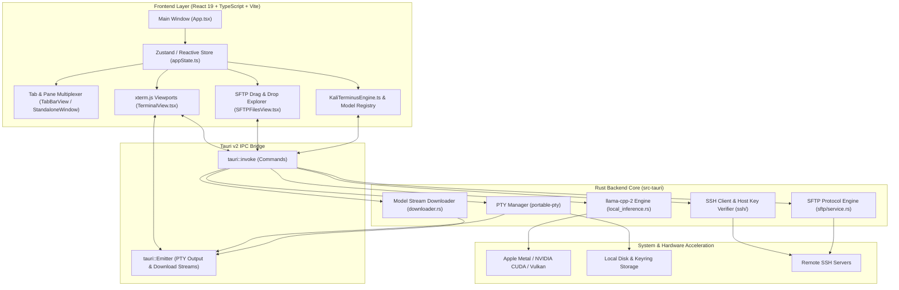

<div align="center">

# ⚡ MyTerminal (Pookie)
### Next-Gen AI-Native Terminal Emulator & Remote Infrastructure Hub

[](https://github.com/parsevoid/pookie/releases/latest)
[](https://tauri.app/)
[](https://www.rust-lang.org/)
[](https://react.dev/)
[](https://www.typescriptlang.org/)
[](https://github.com/ggerganov/llama.cpp)
[](LICENSE)

<br/>

**MyTerminal** (codename *Pookie*) is a high-performance cross-platform terminal emulator built on **Tauri v2**, **Rust**, **React 19**, and **xterm.js**. It features embedded, 100% offline local LLM inference via hardware-accelerated **llama.cpp**, unified SSH connection & credential management, full-fledged SFTP file manager with drag-and-drop, tab and detached pop-up window multiplexing, and reactive custom theme engines.

<br/>

```
 ┌────────────────────────────────────────────────────────────────────────┐
 │  >_ MyTerminal Workspace                                      [—] [O] [X]
 ├───────────┬────────────────────────────────────────────────┬───────────┤
 │  HOSTS    │  tab 1: local-zsh   tab 2: prod-srv  [+]  [^]  │  SFTP /   │
 │  • dev-01 │  ────────────────────────────────────────────  │  AI PANEL │
 │  • aws-ec2│  yogesh@macbook cross-platform % git status    │  • upload │
 │  • home   │  On branch main                                │  • edit   │
 │           │                                                │  • prompt │
 └───────────┴────────────────────────────────────────────────┴───────────┘
```

</div>

---

## 📥 Download Pookie (Latest Release)

Select your platform to download the pre-compiled native installer:

| Platform | Architecture | Package Format | Download Link | Verification |
| :--- | :---: | :---: | :---: | :---: |
| 🍏 **macOS** | Apple Silicon (M1 / M2 / M3 / M4) | `.dmg` (Disk Image) | [⬇️ **Download .dmg (arm64)**](https://github.com/parsevoid/pookie/releases/latest/download/Pookie_0.1.0_aarch64.dmg) | [Checksums](https://github.com/parsevoid/pookie/releases/latest) |
| 🍏 **macOS** | Intel (x86_64) | `.dmg` (Disk Image) | [⬇️ **Download .dmg (x64)**](https://github.com/parsevoid/pookie/releases/latest/download/Pookie_0.1.0_x64.dmg) | [Checksums](https://github.com/parsevoid/pookie/releases/latest) |
| 🍏 **macOS** | Universal Bundle | `.app` (Archive) | [⬇️ **Download .app bundle**](https://github.com/parsevoid/pookie/releases/latest/download/Pookie.app.tar.gz) | [Checksums](https://github.com/parsevoid/pookie/releases/latest) |
| 🪟 **Windows** | Windows 10 / 11 (x64) | `.exe` (NSIS Setup) | [⬇️ **Download Setup .exe**](https://github.com/parsevoid/pookie/releases/latest/download/Pookie_0.1.0_x64-setup.exe) | [Checksums](https://github.com/parsevoid/pookie/releases/latest) |
| 🪟 **Windows** | Windows 10 / 11 (x64) | `.msi` (Enterprise) | [⬇️ **Download .msi Installer**](https://github.com/parsevoid/pookie/releases/latest/download/Pookie_0.1.0_x64_en-US.msi) | [Checksums](https://github.com/parsevoid/pookie/releases/latest) |
| 🐧 **Linux** | Ubuntu / Debian / Mint | `.deb` (Debian Package) | [⬇️ **Download .deb (amd64)**](https://github.com/parsevoid/pookie/releases/latest/download/pookie_0.1.0_amd64.deb) | [Checksums](https://github.com/parsevoid/pookie/releases/latest) |
| 🐧 **Linux** | All Linux Distributions | `.AppImage` (Portable) | [⬇️ **Download .AppImage**](https://github.com/parsevoid/pookie/releases/latest/download/pookie_0.1.0_amd64.AppImage) | [Checksums](https://github.com/parsevoid/pookie/releases/latest) |

> 💡 *Can't find your version? Check the [All Releases](https://github.com/parsevoid/pookie/releases) page for release notes and previous builds.*

---

## 🌟 Key Features

### 🖥️ Native Terminal Core
- **Zero-Latency PTY Backend**: Backed by Rust `portable-pty` with asynchronous I/O and non-blocking streaming.
- **Modern Terminal Capabilities**: Driven by `@xterm/xterm` with `@xterm/addon-fit`, full 24-bit truecolor support, cursor styling, and dynamic viewport reflow.
- **Bi-directional Window Multiplexing**: Seamlessly switch between tabbed layouts, side-by-side split panes, and detached standalone OS windows that synchronize settings and state in real-time.

### 🧠 Embedded On-Device AI Engine (`KaliTerminusEngine`)
- **Zero-Cloud, Private & Offline**: Execute quantized GGUF models directly on your hardware via native `llama-cpp-2` bindings.
- **Hardware Acceleration**: Automatic Metal acceleration on Apple Silicon (macOS), CUDA support on NVIDIA GPUs, and Vulkan on cross-vendor hardware.
- **Intelligent Assistant & Command Palettes**:
  - `AI Command Palette` (`⌘K` / `Ctrl+K`): Translates plain English intents into tested shell commands and contextual workflows.
  - `Snippet Palette` (`#` prefix or `⌘P`): Instant fuzzy search across your curated command snippet library with parameter interpolation.
- **Integrated Model Manager**: In-app one-click downloading, verification, and memory-safe swapping of models.

### 🌐 Secure SSH & SFTP Ecosystem
- **Remote Host Management**: Store, group, and connect to remote servers with configurable ports, users, and jump-hosts.
- **Secure Keyring Storage**: Encrypted credential storage for passwords and passphrases with automated host-key verification and trust handshakes.
- **Full Graphical SFTP Suite**:
  - Bi-directional drag-and-drop file upload/download.
  - Remote file system browsing, recursive directory creation, renaming, and atomic deletion.
  - Direct integration with external editors (VS Code, Cursor, Zed, Sublime Text).
  - Integrated collapsible side panel and standalone dedicated SFTP browser.

### 🎨 Hyper-Reactive Theming & Personalization
- **CSS Variable Injection**: Dynamic token reactivity across typography, borders, background blur, and glow accents.
- **Custom Palettes**: Select from curated developer palettes or design your own hex themes with instant preview.
- **Custom Wallpaper Persistence**: Store and load custom desktop backgrounds via local storage and indexed persistence buffers.
- **Window Opacity & Vibrancy**: Fine-tune background transparency with native platform window blur.

---

## 🏗️ System Architecture



---

## 📁 Repository Directory Structure

```text
cross-platform/
├── package.json                    # Frontend dependencies & package scripts
├── tsconfig.json                   # TypeScript workspace configuration
├── vite.config.ts                  # Vite build bundler configuration
├── .oxlintrc.json                  # High-performance Oxlint rules
│
├── builds/                         # Distributable binaries & installers
│   ├── macos/                      # .dmg, .app, and SHA256SUMS.txt
│   ├── windows/                    # .exe, .msi, and SHA256SUMS.txt
│   └── linux/                      # .deb, .AppImage, and SHA256SUMS.txt
│
├── scripts/
│   └── build-package.js            # Automated build collection & packaging pipeline
│
├── src/                            # React 19 Frontend Codebase
│   ├── main.tsx                    # React DOM root bootstrapping
│   ├── App.tsx                     # Core window layout & modal controllers
│   ├── App.css / index.css         # Global theme tokens, scrollbars & animations
│   │
│   ├── assets/                     # Brand icons, logo, and graphic vectors
│   ├── components/                 # Modular UI component tree
│   │   ├── AICommandPalette/       # ⌘K AI prompt input & suggestion renderer
│   │   ├── Assistant/              # Interactive AI side assistant
│   │   ├── Modals/                 # Connection Manager & Settings Modal
│   │   ├── PaneContainer/          # Resizable multi-terminal layout splits
│   │   ├── Sidebar/                # Left navigation bar (Hosts, Keys, SFTP, Snippets)
│   │   ├── SnippetCommandPalette/  # Quick-snippet search palette (# prefix)
│   │   ├── StandaloneWindow/       # Detached popup window controller
│   │   ├── TabBar/                 # Tabs, pop-out actions, and session counters
│   │   ├── Terminal/               # xterm.js instance lifecycle & input hooks
│   │   └── Views/                  # Management views (SSH Hosts, Keys, SFTP, Snippets)
│   │
│   ├── engine/
│   │   └── KaliTerminusEngine.ts   # Natural language command generator & parser
│   ├── models/
│   │   ├── index.ts                # Type definitions (SSHHost, Connection, Snippet, etc.)
│   │   └── model_registry.json     # Curated catalog of on-device LLM models
│   ├── stores/
│   │   └── appState.ts             # Central persistent application state store
│   ├── styles/
│   │   └── theme.ts                # Predefined palettes, typography, and CSS variable builders
│   └── utils/
│       └── wallpaperStorage.ts     # Custom wallpaper local persistence manager
│
└── src-tauri/                      # Rust Backend Engine
    ├── Cargo.toml                  # Rust crate manifest & dependency tree
    ├── tauri.conf.json             # Tauri v2 window, security, and bundle configuration
    ├── build.rs                    # Native compilation & build hook
    ├── .cargo/config.toml          # Native deployment targets (macOS 11.0+)
    │
    └── src/
        ├── main.rs                 # Application entry, state holder, and IPC dispatcher
        ├── pty.rs                  # Cross-platform PTY management (PTY streams)
        ├── llm/                    # Embedded AI Inference Engine
        │   ├── mod.rs              # LLM module public interface
        │   ├── local_inference.rs  # llama-cpp-2 runtime & context management
        │   ├── downloader.rs       # Chunked resume-supported GGUF model downloader
        │   ├── model_registry.rs   # Rust model verification & status tracker
        │   └── prompt_templates.rs # System prompts tailored for shell commands
        └── ssh/                    # Remote Networking Subsystem
            ├── mod.rs              # SSH controller & session verification
            ├── backend.rs          # Native SSH client integration
            ├── credentials.rs      # Secure platform keychain / credential manager
            ├── host_keys.rs        # Known-hosts checking and key fingerprinter
            ├── editor.rs           # External code editor discovery (VS Code, Zed, etc.)
            └── sftp/               # SFTP File Transfer Subsystem
                ├── protocol.rs     # Binary packet serialization & remote primitives
                └── service.rs      # Upload/download pipeline & drag-and-drop batch worker
```

---

## 🤖 Supported On-Device AI Models

MyTerminal ships with an integrated catalog defined in [`model_registry.json`](file:///Users/yogeshk/Desktop/MyTerminal/cross-platform/src/models/model_registry.json). All models run completely offline on your device:

| Model | Parameters | Quantization | RAM Required | Primary Specialization |
|:---|:---:|:---:|:---:|:---|
| **IBM Granite 3.3** | 2.0B | `Q4_K_M` | ~2.0 GB | Deep enterprise shell scripts, complex pipelines, multi-step CLI reasoning. |
| **Qwen2.5-Coder** | 1.5B | `Q4_K_M` | ~1.5 GB | Precision code generation, Bash scripting, and terminal syntax generation. |
| **SmolLM2 360M** | 360M | `Q4_K_M` | ~512 MB | Ultra-compact, near-instant keystroke autocomplete with microscopic RAM usage. |
| **SmolLM2 3B** | 3.0B | `Q4_K_M` | ~2.5 GB | Strong general-purpose instruction following and terminal troubleshooting. |
| **Qwen3 Series** | 1.7B - 8B | `Q4_K_M` | 1.5 - 6 GB | Scalable high-context reasoning for complex debugging and infrastructure tasks. |
| **Ternary Bonsai** | 1.7B / 27B | Ternary / 1.58b | ~1.5 - 16 GB | Highly experimental ultra-fast ternary weights for low-power architectures. |

---

## ⌨️ Essential Keyboard Shortcuts

| Shortcut (macOS) | Shortcut (Windows/Linux) | Action |
|:---|:---|:---|
| `⌘ + K` | `Ctrl + K` | Open **AI Command Palette** (Natural Language to Shell) |
| `⌘ + P` | `Ctrl + P` | Open **Snippet Command Palette** / Quick Switcher |
| `⌘ + T` | `Ctrl + T` | New Terminal Tab |
| `⌘ + W` | `Ctrl + W` | Close Active Terminal Tab |
| `⌘ + ,` | `Ctrl + ,` | Open Application Settings & Model Manager |
| `⌘ + \` | `Ctrl + \` | Toggle Integrated SFTP Side Panel |
| `⌘ + Shift + D` | `Ctrl + Shift + D` | Detach Active Tab into Standalone Floating Window |

---

## 🚀 Building from Source

### Prerequisites
- **Node.js**: `v18.0.0+`
- **Rust Toolchain**: `rustc`, `cargo` (stable)
- **C/C++ Build Tools**: Xcode CLI (macOS), Visual Studio Build Tools (Windows), or `build-essential` (Linux)

### Development
```bash
# 1. Install dependencies
npm install

# 2. Run local dev server with hot reload
npm run tauri dev
```

### Local Release Packaging
```bash
# Automatically builds, packages into builds/<platform>/, and calculates SHA256
npm run build:package
```

---

<div align="center">
  <sub>Crafted with ❤️ for developers, sysadmins, and security engineers.</sub>
</div>
