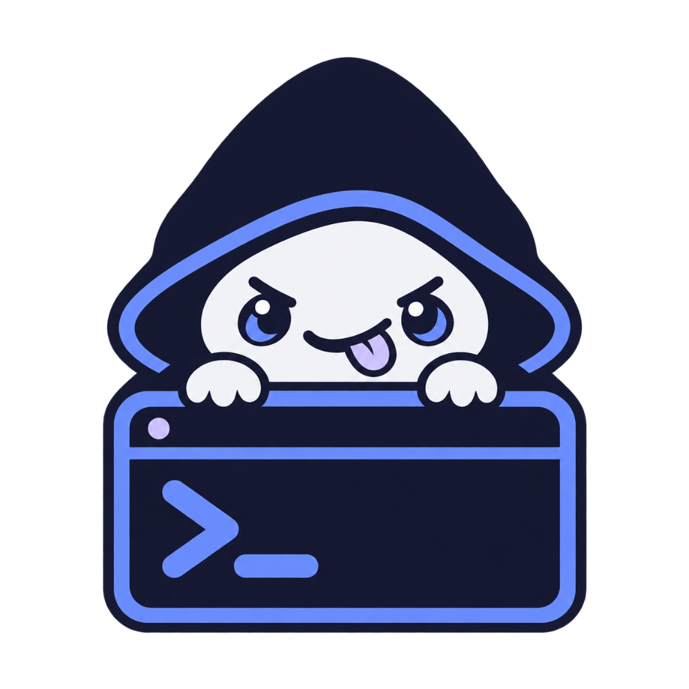

<div align="center">



# Pookie (Terminal)

**A fast, native terminal emulator with on-device local AI, SSH host manager, and drag-and-drop SFTP.**

[](https://github.com/parsevoid/pookie/releases/latest)
[](https://tauri.app/)
[](https://www.rust-lang.org/)
[](https://react.dev/)
[](https://www.typescriptlang.org/)
[](LICENSE)

</div>

---

Most terminal setups force you to juggle separate tools: a terminal window, an SSH config file, an SFTP client like Cyberduck or FileZilla to move files, and cloud-based AI tools that send your proprietary terminal commands over the internet.

**Pookie** brings everything into one fast desktop application:
1. A zero-latency local terminal backed by native Rust PTY.
2. An **on-device LLM engine** (`llama.cpp`) running quantized GGUF models directly on your GPU (Apple Metal or NVIDIA CUDA) with zero data leaving your machine.
3. An integrated **SSH host manager** and **graphical SFTP explorer** with drag-and-drop uploads and external editor sync (VS Code, Cursor, Zed).
4. Tab management with detached pop-out windows and custom themes.

---

## Downloads

Pre-built binaries are available for macOS, Windows, and Linux. Choose the installer for your system:

| Platform | Architecture | Type | Download |
| :--- | :--- | :--- | :--- |
|  | Apple Silicon (M1/M2/M3/M4) | DMG Installer | [-1e293b?style=flat-square&logo=apple&logoColor=white)](https://github.com/parsevoid/pookie/releases/latest/download/Pookie_0.1.0_aarch64.dmg) |
|  | Intel (x86_64) | DMG Installer | [-334155?style=flat-square&logo=apple&logoColor=white)](https://github.com/parsevoid/pookie/releases/latest/download/Pookie_0.1.0_x64.dmg) |
|  | macOS Universal | App Bundle | [](https://github.com/parsevoid/pookie/releases/latest/download/Pookie.app.tar.gz) |
|  | Windows 10 / 11 (64-bit) | Setup (.exe) | [-0284c7?style=flat-square&logo=windows&logoColor=white)](https://github.com/parsevoid/pookie/releases/latest/download/Pookie_0.1.0_x64-setup.exe) |
|  | Windows 10 / 11 (64-bit) | MSI Package | [-0369a1?style=flat-square&logo=windows&logoColor=white)](https://github.com/parsevoid/pookie/releases/latest/download/Pookie_0.1.0_x64_en-US.msi) |
|  | Debian / Ubuntu / Mint | DEB Package | [-c2410c?style=flat-square&logo=ubuntu&logoColor=white)](https://github.com/parsevoid/pookie/releases/latest/download/pookie_0.1.0_amd64.deb) |
|  | Any 64-bit Linux | AppImage | [](https://github.com/parsevoid/pookie/releases/latest/download/pookie_0.1.0_amd64.AppImage) |

Every release includes a `SHA256SUMS.txt` file on the [GitHub Releases](https://github.com/parsevoid/pookie/releases/latest) page so you can verify the integrity of your download.

---

## What's Inside

### Native Terminal
- Driven by `@xterm/xterm` with `@xterm/addon-fit` on the frontend and `portable-pty` in Rust.
- Full 24-bit RGB truecolor, smooth font rendering, and instant resizing without cursor misalignment.
- Multi-tab management, side-by-side pane container, and the ability to pop any tab out into a standalone window that continues sharing settings in real time.

### On-Device AI Command Assistant
- **100% Offline & Private**: Uses embedded `llama-cpp-2` bindings to run quantized `.gguf` models directly on your hardware. No API keys, no subscriptions, and no external network calls required.
- **Hardware Acceleration**: Utilizes Apple Metal on macOS, NVIDIA CUDA on Linux/Windows, and Vulkan on cross-vendor graphics cards.
- **Command Palette (`Cmd+K` / `Ctrl+K`)**: Describe what you want in plain words (e.g., *"find all files modified in the last 2 hours larger than 50MB"*), and get verified, runnable shell commands.
- **Snippet Library (`#` or `Cmd+P`)**: Search custom snippets instantly by prefixing queries with `#`.
- **Model Switcher**: Easily download and swap models inside **Settings -> Models**:
  - **SmolLM2 360M**: Ultra-fast (~512MB RAM), ideal for real-time keystroke suggestions.
  - **Qwen2.5-Coder 1.5B**: Great for Bash and shell script generation (~1.5GB RAM).
  - **Granite 3.3 2B**: IBM's logic-focused model for complex command sequences (~2GB RAM).
  - **SmolLM2 3B / Qwen3**: Higher accuracy models for in-depth troubleshooting.

### Remote SSH & SFTP Manager
- **Connection Profiles**: Save servers with host, port, username, key file, or password.
- **Host Key Safety**: Automatic known-hosts verification with fingerprint confirmation dialogs.
- **Side Panel & Standalone SFTP**:
  - Drag files from your desktop directly into the SFTP pane to upload.
  - Download remote files or entire folders with a click.
  - Open any remote file directly in your preferred desktop editor (VS Code, Cursor, Zed, Sublime) with automatic sync-back on save.

### Theming & Personalization
- Includes preset color palettes (Slate, Cyberpunk, Monochrome, Midnight).
- Adjust window background transparency, blur strength, and UI size presets.
- Set custom wallpaper backgrounds directly stored and loaded locally.

---

## Keyboard Shortcuts

| Shortcut (macOS) | Shortcut (Windows / Linux) | Action |
| :--- | :--- | :--- |
| `⌘ K` | `Ctrl + K` | Open AI Command Palette |
| `⌘ P` | `Ctrl + P` | Open Snippet Search / Quick Switcher |
| `⌘ T` | `Ctrl + T` | New Terminal Tab |
| `⌘ W` | `Ctrl + W` | Close Current Tab |
| `⌘ \` | `Ctrl + \` | Toggle SFTP Side Panel |
| `⌘ Shift D` | `Ctrl + Shift + D` | Detach active tab into separate floating window |
| `⌘ ,` | `Ctrl + ,` | Open Settings & Model Manager |

---

## Building from Source

### Prerequisites

Make sure you have installed:
1. **Node.js** (v18 or newer)
2. **Rust & Cargo** (stable toolchain from [rustup.rs](https://rustup.rs))
3. **C/C++ Build Tools**:
   - macOS: `xcode-select --install`
   - Linux: `sudo apt install libwebkit2gtk-4.1-dev build-essential curl libssl-dev libayatana-appindicator3-dev librsvg2-dev`
   - Windows: Visual Studio C++ Build Tools & WebView2 runtime

### 1. Clone & Install Dependencies
```bash
git clone https://github.com/parsevoid/pookie.git
cd pookie
npm install
```

### 2. Run in Development Mode
```bash
npm run tauri dev
```
This boots Vite at `http://localhost:5173` and starts the Rust desktop backend with live reload.

### 3. Build Production Installer
```bash
npm run build:package
```
This runs the full release build, collects the final installers into `builds/<platform>/` (e.g. `builds/macos/Pookie_0.1.0_aarch64.dmg`), and creates a `SHA256SUMS.txt` file automatically.

---

## Codebase Architecture

```text
pookie/
├── src/                          # React 19 Frontend
│   ├── components/
│   │   ├── Terminal/             # xterm.js terminal integration & input handling
│   │   ├── AICommandPalette/     # Natural language command input modal
│   │   ├── SnippetCommandPalette/# Fast snippet picker (# prefix)
│   │   ├── Sidebar/              # Navigation bar (Hosts, Keys, SFTP, Snippets)
│   │   ├── TabBar/               # Tabs & window pop-out controls
│   │   ├── StandaloneWindow/     # Detached pop-up window view
│   │   └── Views/                # SFTP explorer, SSH hosts & keys tables
│   ├── engine/
│   │   └── KaliTerminusEngine.ts # Prompt formatting and routing to local LLM
│   ├── stores/
│   │   └── appState.ts           # Central state store (tabs, connections, settings)
│   └── styles/
│       └── theme.ts              # Palettes and dynamic CSS variables
│
├── src-tauri/                    # Rust Tauri v2 Backend
│   ├── src/
│   │   ├── main.rs               # Application lifecycle and IPC command registry
│   │   ├── pty.rs                # PTY session management via portable-pty
│   │   ├── llm/                  # llama-cpp-2 inference runtime & GGUF downloader
│   │   └── ssh/                  # SSH connection handling, credentials, and SFTP service
│   ├── Cargo.toml                # Rust dependencies and feature flags (metal, cuda, vulkan)
│   └── tauri.conf.json           # Window configuration and security permissions
│
├── builds/                       # Local build output destination (organized by platform)
└── scripts/
    └── build-package.js          # Build script that packages and hashes installers
```

---

## Privacy & Security

- **Zero Telemetry**: Pookie does not track your keystrokes, terminal commands, or usage statistics.
- **Local AI Only**: All model inferences happen directly on your CPU/GPU using `llama.cpp`. Your terminal context never leaves your computer.
- **Encrypted Credentials**: SSH passwords and key passphrases are handled through platform-secured credential storage.

---

## License

This project is licensed under the [MIT License](LICENSE).
